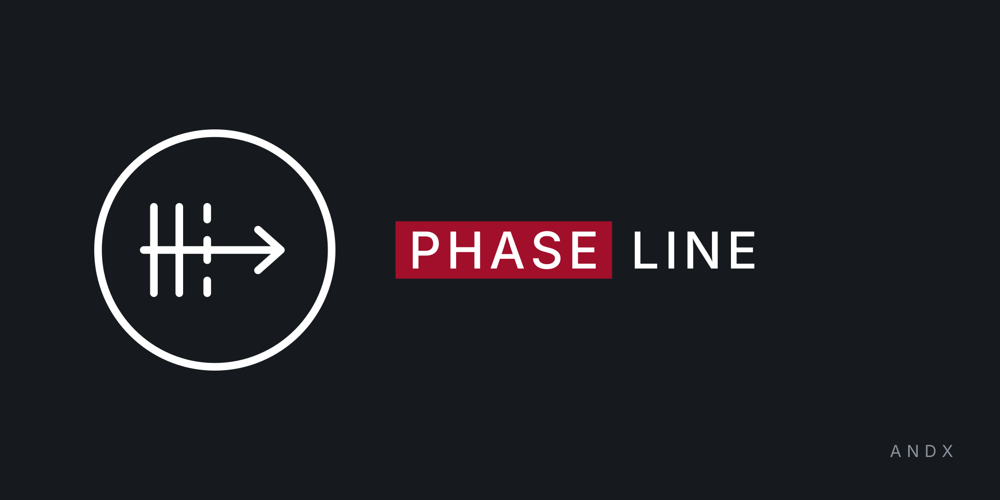

# Phase Line

_Your plan, ready when you are._

<p align="center">
    
</p>

<p align="center">
    <a href="https://github.com/Andx667/phaseline/issues">
        
    </a>
    <a href="https://steamcommunity.com/sharedfiles/filedetails/?id=3811355264">
        
    </a>
    <a href="https://github.com/Andx667/phaseline/blob/main/LICENSE">
        
    </a>
    <br>
    
    
</p>

__Requires__ [CBA_A3](https://github.com/CBATeam/CBA_A3) and [ACE3](https://github.com/acemod/ACE3).

__Phase Line__ (PL) saves the map markers you place as named "phases" in your own profile and loads them again later on the same map. Plan in the local multiplayer preview (Eden), then bring the plan onto the map phase by phase in the real multiplayer.

__Client-side only__: no server installation required, other players do not need the mod. Servers that verify signatures must allow its key.

The project is entirely __open-source__ and any contributions are welcome.

Steam Workshop: <https://steamcommunity.com/sharedfiles/filedetails/?id=3811355264>  
Discord: <https://discord.gg/ag4v6kxYAa>

## Features

The system can be accessed through several modes. The default is chat commands, but you can switch the access mode from the CBA settings menu to ACE interaction or both. Both offer the same features.

- `#savemarkers [name]` saves your markers (including drawn lines) as a new phase. By default only markers that are not yet in any phase are saved, so you can draw phase 1, save, draw phase 2, save. `--all` saves every marker. An existing name is overwritten.
- `#savemarkers [name] --other` saves the markers placed by other players instead of your own.
- `#loadmarkers [phase] [channel]` recreates a phase on the current map. Without arguments the next phase that isn't on the map yet is loaded. `channel` is `global`, `side`, `command`, `group`, `vehicle` or `direct` (default: side); `local` shows the markers only to you.
- `#unloadmarkers [phase]` removes the markers of a loaded phase again.
- `#listmarkers` lists the saved phases of the current map.
- `#deletemarkers <phase>` deletes a saved phase from your profile.

The ACE self-interaction menu "Phase Line" has the same functions:

- __Save markers__ saves the new markers under the next free default name. Its sub-menu lists every other player who placed markers; selecting one saves that player's markers as a phase named after the player. "All other players" saves them together. The CBA setting "Show other players in the save menu" hides this sub-menu. __Save markers as...__ opens a dialog for the name and for saving every marker; that option is preselected when all your markers are already in a phase.
- __Load markers__ loads the next phase. Its sub-menu lists the phases that are not loaded yet; selecting one loads it on the default channel, its own sub-menu picks the channel or "Local only".
- __Unload markers__ removes the most recently loaded phase, its sub-menu lists every loaded phase.
- __List markers__ lists the saved phases of the current map.
- __Delete phase__ lists the saved phases, each with a "Confirm" entry that deletes it.

Saving works in any multiplayer session, including the local multiplayer preview. Singleplayer has no chat, so there Phase Line works once the access mode is set to ACE interaction or both. A phase saved from other players' markers loads like any other: the markers are recreated as your own on the channel you choose, so check the channel before sharing markers that were not placed on it. Only markers your client received can be saved, not those on channels you are not part of.

Phases are stored per player in the Arma profile and per map. At most 500 markers fit in one phase.

## Settings

Both are client settings in CBA settings, category "Phase Line", so each player sets them for themselves.

- __Access mode__ (`pl_phaseline_accessMode`): chat commands (default), ACE interaction or both.
- __Show other players in the save menu__ (`pl_phaseline_saveOthers`, on by default): shows the per-player entries under "Save markers" in the ACE menu. `#savemarkers --other` works either way.

## Functions for missions and other mods

The chat commands and ACE entries call these functions, so missions and other mods can use them too. All of them work only on the client that calls them: they read and write that player's profile and show their result as a hint to that player. Call them where `hasInterface` is true, for example from a client's `initPlayerLocal.sqf` or an addAction, not on a dedicated server. Phases are always those of the current map.

A phase can be given by name or by its 1-based position in the `#listmarkers` list.

### `pl_phaseline_fnc_savePhase`

Saves the local player's markers as a phase. An existing phase with the same name is overwritten. In singleplayer it only saves when the access mode includes ACE interaction.

| # | Argument | Default |
| --- | --- | --- |
| 0 | Phase name (string), empty for the next free "Phase N" | `""` |
| 1 | Only save markers that are not in a phase yet this session (bool) | `true` |
| 2 | Markers to save instead of the player's own (array of marker names) | own markers |

Returns `true` if the phase was saved.

```sqf
["Phase 1"] call pl_phaseline_fnc_savePhase;
["Full plan", false] call pl_phaseline_fnc_savePhase;
```

### `pl_phaseline_fnc_saveOtherMarkers`

Saves the markers that other players placed and the local client knows about as a phase.

| # | Argument | Default |
| --- | --- | --- |
| 0 | Phase name (string), empty for the player's name (with a player ID) or the next "Phase N" | `""` |
| 1 | Only save markers that are not in a phase yet this session (bool) | `true` |
| 2 | Player ID (`getPlayerID`) whose markers to save (string), empty for all other players | `""` |

Returns `true` if the phase was saved.

```sqf
[] call pl_phaseline_fnc_saveOtherMarkers;
["", false, getPlayerID _unit] call pl_phaseline_fnc_saveOtherMarkers;
```

### `pl_phaseline_fnc_loadPhase`

Recreates a phase as the local player's own markers. The markers are created a few per frame and, unless loaded locally, sent to everyone on the chosen channel. In singleplayer they are always local.

| # | Argument | Default |
| --- | --- | --- |
| 0 | Phase (string or number), `-1` for the first phase that is not loaded yet | `-1` |
| 1 | Channel name (`"global"`, `"side"`, `"command"`, `"group"`, `"vehicle"`, `"direct"`) or ID (string or number), `-1` for side or the first channel that allows markers | `-1` |
| 2 | Only show the markers to the local player (bool) | `false` |

Returns `true` if loading started.

```sqf
[] call pl_phaseline_fnc_loadPhase;
["Phase 2", "group"] call pl_phaseline_fnc_loadPhase;
[1, -1, true] call pl_phaseline_fnc_loadPhase;
```

### `pl_phaseline_fnc_unloadPhase`

Deletes the markers of a phase loaded this session.

| # | Argument | Default |
| --- | --- | --- |
| 0 | Phase (string or number), `-1` for the most recently loaded phase | `-1` |

Returns `true` if a phase was unloaded.

```sqf
[] call pl_phaseline_fnc_unloadPhase;
["Phase 2"] call pl_phaseline_fnc_unloadPhase;
```

### `pl_phaseline_fnc_listPhases`

Shows the saved phases as a hint. No arguments. Returns `true` if there is at least one phase.

```sqf
[] call pl_phaseline_fnc_listPhases;
```

### `pl_phaseline_fnc_deletePhase`

Deletes a saved phase from the profile. Its markers stay on the map if it is loaded.

| # | Argument | Default |
| --- | --- | --- |
| 0 | Phase (string or number) | `""` |

Returns `true` if the phase was deleted.

```sqf
["Phase 1"] call pl_phaseline_fnc_deletePhase;
```

## Contributing

For new contributors, see the [Contributing Setup & Guidelines](./.github/CONTRIBUTING.md).

## License

Phase Line is licensed under [MIT](./LICENSE).
